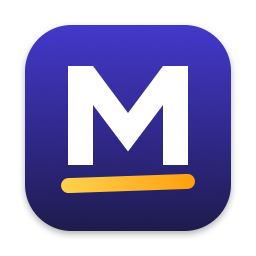
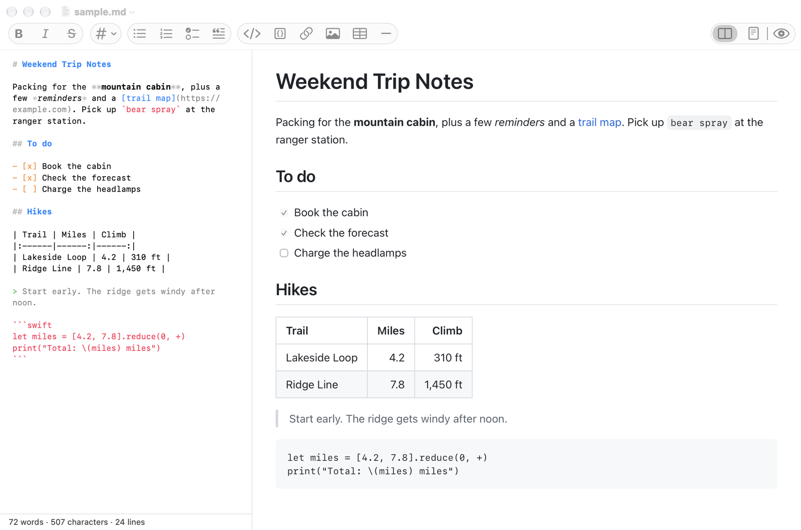

<p align="center"></p>

<h1 align="center">Marked</h1>

<p align="center">A small, fast, native Markdown editor for macOS.</p>

<p align="center"><a href="https://github.com/muhleake/marked/releases/latest/download/Marked.dmg"><b>Download Marked for macOS</b></a></p>

Marked is a native macOS Markdown editor: raw text on the left, a live GitHub-flavored preview on the right, and a formatting toolbar on top. It opens, edits and creates `.md`, `.markdown`, `.mdown` and `.txt` files, and nothing else.



Marked isn't affiliated with the commercial Marked 2 app. It has no accounts, telemetry, auto-updater, cloud sync or network access.

## Features

- **Native document handling:** one window per document, tabs, autosave, Versions, Revert To, Duplicate, Rename, Move To, Open Recent, Find & Replace, spell check, print, and window restoration on relaunch.
- **Live preview:** tables, task lists, strikethrough, autolinks, footnotes, code blocks and relative images. Follows light and dark mode. Switch between Split, Editor Only and Preview Only with ⌥⌘P.
- **Two-way scroll sync:** scroll either pane and the other follows.
- **Zoom:** ⌘+ and ⌘− scale both panes. Preview Zoom scales only the preview, and Scale to Window sizes it to its pane. Pinch works in the preview too.
- **Formatting toolbar:** every button works on the selection, toggles off, and undoes in one step. Shortcuts are listed below.
- **Editor:** color and weight tinting that never hides characters, list continuation, Tab and Shift-Tab indenting, adjustable font size, and a word, character and line count.
- **Plain text:** `.txt` files open editor-only. View ▸ Treat as Markdown turns the preview on for that window without renaming the file.
- **Output:** Print and Export as PDF use the rendered preview. Edit ▸ Copy as HTML copies the rendered selection or the whole document.
- **File handling:** reads UTF-8, UTF-16 and Windows-1252, always writes UTF-8, keeps LF or CRLF line endings, and prompts to reload when another app changes the file.

## Install

1. [Download Marked.dmg](https://github.com/muhleake/marked/releases/latest/download/Marked.dmg), open it, and drag Marked to Applications.
2. Open Marked. macOS says it can't verify the app, because Marked isn't notarized by Apple. Click Done.
3. Open System Settings ▸ Privacy & Security, scroll down, and click **Open Anyway**.

You only need to do this once. Marked needs macOS 14 or later and has only been tested on macOS 27.0.1 on Apple silicon. It doesn't update itself, so check [Releases](https://github.com/muhleake/marked/releases) for new versions.

To make Marked the default app for a file type, use Finder: Get Info on a file ▸ Open with: Marked ▸ Change All.

## Build from source

You only need this to change the code. It requires:

- Xcode (tested with 27.1)
- [XcodeGen](https://github.com/yonaskolb/XcodeGen): `brew install xcodegen`

The Xcode project is generated from `project.yml` and isn't checked in. The Makefile runs XcodeGen for you.

```bash
make build
```

```bash
make test
```

```bash
make run
```

```bash
make install
```

`make icon` regenerates the app icon from `assets/AppIcon.svg`.

`make install` builds a Release copy and puts it in `/Applications`. Builds are ad-hoc signed, so no Apple developer account is needed.

`make dmg` packages the Release build as `build.noindex/Marked.dmg`.

## Keyboard shortcuts

| Action | Shortcut | Action | Shortcut |
| --- | --- | --- | --- |
| Bold | ⌘B | Bulleted list | ⇧⌘8 |
| Italic | ⌘I | Numbered list | ⇧⌘7 |
| Strikethrough | ⇧⌘X | Task list | ⇧⌘T |
| Heading 1–6 | ⌘1–⌘6 | Quote | ⇧⌘. |
| Link | ⌘K | Inline code | ⌥⌘C |
| Image | ⇧⌘I | Code block | ⇧⌘C |
| Table | ⌥⌘T | Horizontal rule | ⇧⌘- |
| Cycle layout | ⌥⌘P | Zoom both panes | ⌘+ / ⌘− / ⌘0 |
| Editor text size | ⌃⌘= / ⌃⌘- / ⌃⌘0 | Zoom preview only | ⌥⌘= / ⌥⌘- / ⌥⌘0 |

The ⇧⌘8, ⇧⌘7, ⇧⌘. and ⇧⌘- shortcuts assume a US keyboard layout.

## Project layout

```
Marked/
  App/         App delegate and the main menu (built in code)
  Document/    NSDocument subclass, document controller, file encoding
  Window/      Document window, split view, layouts
  Editor/      Text view, tinting, Markdown commands, list handling, status counts
  Preview/     cmark rendering, WKWebView preview, printing, content blocking
  Toolbar/     NSToolbar setup
  Settings/    Preferences and the Settings window
  Resources/   App icon
MarkedTests/   Unit and in-app integration tests
assets/        Vector source for the app icon
scripts/       Icon rendering and disk image scripts
docs/          Report, spec, build log and behavior reference
project.yml    XcodeGen project definition
Makefile       Build, test, run and install
```

## Documentation

- [Changelog](CHANGELOG.md)
- [Project and performance report](docs/REPORT.md)
- [Original spec](docs/SPEC.md)
- [Build log and acceptance results](docs/PROGRESS.md)
- [Behavior reference](docs/BEHAVIOR.md)

## Dependencies

The only third-party dependency is [swift-cmark](https://github.com/apple/swift-cmark), Apple's fork of cmark-gfm, which is BSD-2-Clause licensed. It's pinned to a specific revision in `project.yml`.

## Acknowledgments

The zoom approach and the idea of limiting work to what changed came from studying [MarkEdit](https://github.com/MarkEdit-app/MarkEdit), an MIT-licensed Markdown editor. No code was copied.

## License

Marked is released under the [MIT License](LICENSE). Versions up to and including 1.1 were released under the Unlicense, and those copies keep that license.

swift-cmark keeps its own BSD-2-Clause license. Its notice is included in the app, at `Contents/Resources/Licenses`, alongside Marked's.
